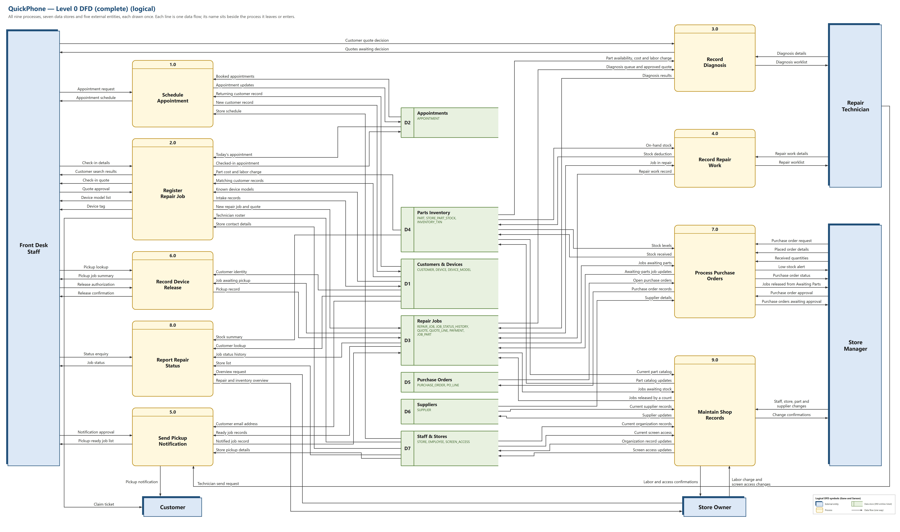
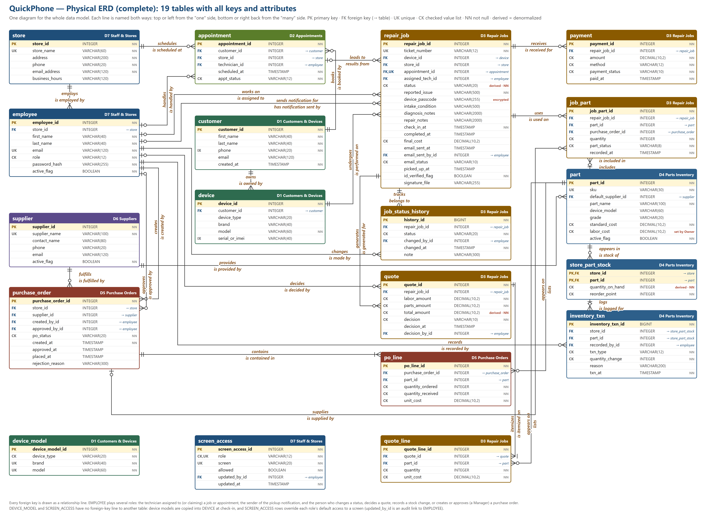

# Design documents

This folder holds the analysis and design behind the working system in [`../app`](../app). Each document is the current version.

| Document | File |
|---|---|
| System request | [system-request.docx](system-request.docx) |
| Requirements catalog (15 functional, 6 non-functional) | [requirements-catalog.docx](requirements-catalog.docx) |
| Use cases (UC-01 to UC-13) | [use-cases.docx](use-cases.docx) · [diagram](use-case-diagram.png) |
| Data flow diagrams, logical and physical | [dfd/](dfd) · [physical set (PDF)](dfd/physical-dfd-set.pdf) |
| Entity relationship diagrams, logical and physical | [erd/](erd) · [physical ERD (PDF)](erd/physical-erd.pdf) |
| DFD to ERD alignment | [dfd-erd-alignment.png](dfd-erd-alignment.png) |
| Specification document | [specification.docx](specification.docx) |

## Data flow diagrams

The context diagram and Level 0 come first. Level 0 is shown complete and in four parts, followed by a Level 1 diagram for each process. The logical set shows what the system does, and the physical set shows how it does it.

| Diagram | Logical | Physical |
|---|---|---|
| Context | [view](dfd/logical/01-context.png) | [view](dfd/physical/01-context.png) |
| Level 0, complete | [view](dfd/logical/02-level-0.png) | [view](dfd/physical/02-level-0.png) |
| Level 0, part 1: booking and check-in | [view](dfd/logical/03-level-0-part-1-booking-check-in.png) | [view](dfd/physical/03-level-0-part-1-booking-check-in.png) |
| Level 0, part 2: bench | [view](dfd/logical/04-level-0-part-2-bench.png) | [view](dfd/physical/04-level-0-part-2-bench.png) |
| Level 0, part 3: notice and release | [view](dfd/logical/05-level-0-part-3-notice-release.png) | [view](dfd/physical/05-level-0-part-3-notice-release.png) |
| Level 0, part 4: back office | [view](dfd/logical/06-level-0-part-4-back-office.png) | [view](dfd/physical/06-level-0-part-4-back-office.png) |
| 1.0 Schedule appointment | [view](dfd/logical/07-level-1-1.0-schedule-appointment.png) | [view](dfd/physical/07-level-1-1.0-schedule-appointment.png) |
| 2.0 Register repair job | [view](dfd/logical/08-level-1-2.0-register-repair-job.png) | [view](dfd/physical/08-level-1-2.0-register-repair-job.png) |
| 3.0 Record diagnosis | [view](dfd/logical/09-level-1-3.0-record-diagnosis.png) | [view](dfd/physical/09-level-1-3.0-record-diagnosis.png) |
| 4.0 Record repair work | [view](dfd/logical/10-level-1-4.0-record-repair-work.png) | [view](dfd/physical/10-level-1-4.0-record-repair-work.png) |
| 5.0 Send completion notice | [view](dfd/logical/11-level-1-5.0-send-completion-notice.png) | [view](dfd/physical/11-level-1-5.0-send-completion-notice.png) |
| 6.0 Record device release | [view](dfd/logical/12-level-1-6.0-record-device-release.png) | [view](dfd/physical/12-level-1-6.0-record-device-release.png) |
| 7.0 Process purchase orders | [view](dfd/logical/13-level-1-7.0-process-purchase-orders.png) | [view](dfd/physical/13-level-1-7.0-process-purchase-orders.png) |
| 9.0 Maintain shop records | [view](dfd/logical/14-level-1-9.0-maintain-shop-records.png) | [view](dfd/physical/14-level-1-9.0-maintain-shop-records.png) |

## Entity relationship diagrams

The ERD has 19 entities. It is shown in full, then as an overview with three detail views.

| View | Logical | Physical |
|---|---|---|
| Full | [view](erd/logical/full.png) | [view](erd/physical/full.png) |
| Overview | [view](erd/logical/overview.png) | [view](erd/physical/overview.png) |
| Detail 1 | [view](erd/logical/detail-1.png) | [view](erd/physical/detail-1.png) |
| Detail 2 | [view](erd/logical/detail-2.png) | [view](erd/physical/detail-2.png) |
| Detail 3 | [view](erd/logical/detail-3.png) | [view](erd/physical/detail-3.png) |

