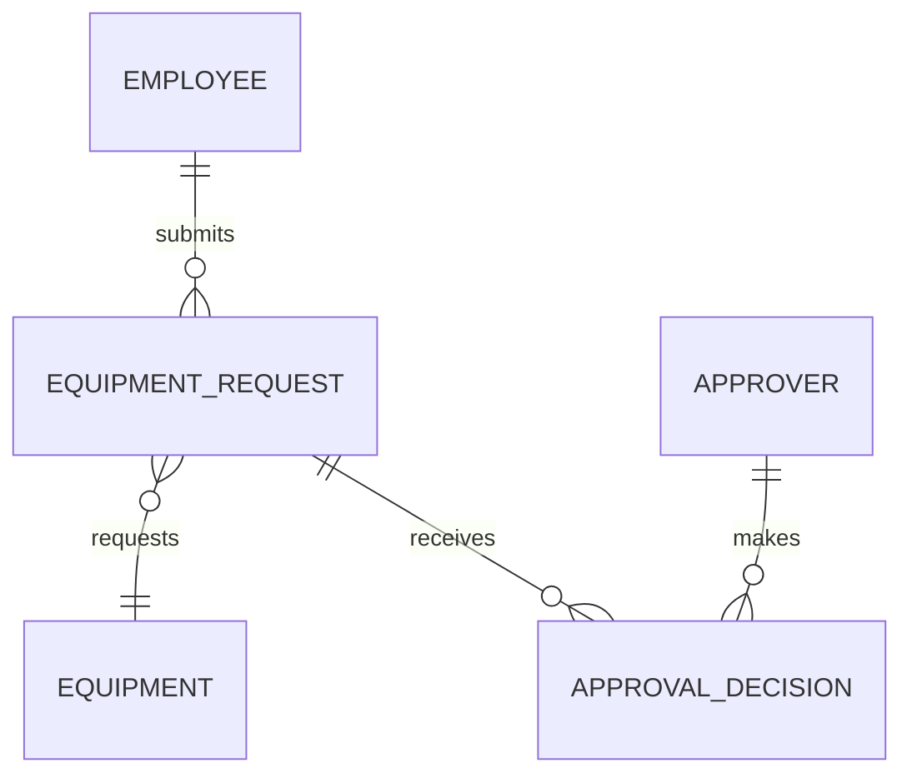

# MIS 4173 AI Guidelines

*MIS 4173 | ChatGPT Edu Usage Guidelines, East Carolina University, College of Business, Management Information Systems. Transcribed from the course handout on 2026-10-22; the Canvas copy is authoritative. Figures are omitted.*

## Using AI in MIS 4173: guidelines for Systems Analysis, Design, and Development

**The standard:** AI use is required, documented, and evaluated. Your grade depends less on what AI produces than on how well your team validates, improves, and defends it.

### Three principles govern AI use

| # | Principle | What it means |
|---|---|---|
| 1 | Construct before you generate | Create a bounded manual example before asking AI to produce the complete artifact. |
| 2 | Every contribution gets a decision | Record whether the team accepted, modified, or rejected each substantive AI contribution and explain why. |
| 3 | Judgment is graded, not polish | Every team member must be able to validate and defend the team's decisions. |

### Set up the course workspace

Create a dedicated MIS 4173 ChatGPT Project for course context. Keep official team records and application files in the systems designated below.

| Tool | Primary purpose |
|---|---|
| ChatGPT Project | Course context, analysis, drafting, and feedback |
| Microsoft Teams | Official shared files, meeting minutes, and collaboration records |
| GitHub | Authoritative application source, change history, and recovery points |
| AI Decision Log | Record of substantive AI contributions and team judgments |

## Prompt with CARE

A strong prompt improves the quality of AI output; it does not prove that the output is correct.

| | CARE | Include (MIS 4173 application) |
|---|---|---|
| C | Context | System, stakeholder, evidence, and current project state |
| A | Action | Explain, analyze, compare, generate, test, or review |
| R | Requirements | Format, constraints, standards, sources, and acceptance criteria |
| E | Example | A sample showing the expected structure or level of detail |

**Example requirements prompt:** "Our team is developing an equipment-request tracker. Review the attached interview notes and identify candidate functional requirements. Present them in a table with an ID, requirement statement, source evidence, priority, and unresolved question. Do not invent requirements. Distinguish explicit stakeholder statements from your inferences."

## The required AI workflow

| Step | Team action |
|---|---|
| 1 | Create a bounded portion manually so the team understands the artifact. |
| 2 | Give AI the relevant evidence, current artifacts, constraints, and desired output. |
| 3 | Generate or revise a clearly bounded artifact or change. |
| 4 | Compare the result with stakeholder evidence and related project artifacts. |
| 5 | Accept, modify, or reject the contribution. |
| 6 | Record the contribution and rationale in the AI Decision Log. |
| 7 | Revise when feedback or downstream changes require it; update the Sprint Change Log. |

### What requires an AI Decision Log entry?

| Decision | Guidance |
|---|---|
| Log it | Requirements, use cases, models, prototypes, substantive code, test cases, security recommendations, and user documentation |
| Usually skip it | Grammar corrections, spelling, simple formatting, and other changes that do not affect meaning or behavior |
| Use judgment | If the contribution could change a requirement, design decision, system behavior, risk, or client outcome, log it |

**Be ready to defend it.** The instructor may select any Decision Log entry and ask any team member to explain the team's rationale.

## Use AI across the systems development life cycle

| Phase | Appropriate AI assistance | Team validation |
|---|---|---|
| Planning | Ideas, feasibility questions, risk identification | Claims trace to evidence; value and constraints are explicit |
| Analysis | Requirements, use cases, logical models | No invented requirements; models balance and align |
| Design | Physical models, interface alternatives, architecture | Alternatives are compared; sponsor feedback drives selection |
| Implementation | Code, database changes, tests, security checks | Changes satisfy the specification and pass verification |
| Deployment | Deployment steps, training, user documentation | Instructions match the working system and realistic environment |

### Validate alignment, not just accuracy

A project artifact can be individually plausible and still be wrong for the system. Check the full chain:

| Link | Validation question |
|---|---|
| Business problem | What problem or opportunity is the system addressing? |
| Requirements | What must the system do, and what evidence supports it? |
| Models | Do processes, data, and interactions represent those requirements? |
| Design | Do interfaces and architecture implement the models? |
| Code | Does system behavior match the approved design and acceptance criteria? |
| Tests | Do tests demonstrate that the required behavior works and failures are handled? |

### Artifact review questions

- What evidence supports this element?
- What assumptions did the AI make?
- What did the AI omit, exaggerate, or invent?
- Does this conflict with another requirement, model, or design decision?
- What would happen if the team accepted this without modification?
- Can the team explain why this is appropriate for the client?

**Stopping decision:** Analysis is not complete because AI produced a long list. The team must justify why it has enough evidence to proceed and identify what uncertainty remains.

## Use Mermaid for diagramming

Mermaid creates diagrams from editable text. This makes diagrams easy to revise, compare, and store with project documentation or source code.

| Use | Guidance |
|---|---|
| Good fit | ERDs, sequence diagrams, state diagrams, architecture diagrams, and exploratory flowcharts |
| Use cautiously | Context diagrams and DFD drafts created with flowchart syntax |
| Not sufficient by itself | A polished rendering does not establish correct notation, balancing, decomposition, cardinality, or semantic accuracy |

**DFD requirement:** Mermaid does not provide dedicated data-flow-diagram notation. It may help a team draft or reason through a DFD, but final graded DFDs must use recognizable DFD notation and satisfy course modeling rules. Use another diagramming tool when Mermaid cannot represent the required notation clearly.

### Mermaid workflow

| Step | Team action |
|---|---|
| 1 | Define the purpose, boundary, and evidence; request Mermaid code plus a separate assumptions list. |
| 2 | Render the code and correct syntax problems. |
| 3 | Validate meaning: names, relationships, labels, cardinalities, flows, boundaries, and consistency. |
| 4 | Export the diagram and preserve the Mermaid source for revision. |
| 5 | Log the generation and the team's accept/modify/reject decision. |

Example Mermaid ERD:

**Mermaid prompt pattern:** "Using only the approved requirements below, create Mermaid syntax for a logical ERD. Include entities, primary keys, important attributes, relationships, and cardinalities. Do not add unsupported entities or attributes. After the code, list modeling assumptions separately."

**Before accepting a diagram, check** that every element is supported by evidence or a documented assumption; names remain consistent across artifacts; cardinality, direction, decomposition, and boundaries are correct; and the exported diagram remains readable.

## Use Codex for specification-driven coding

Codex can work through a connected repository, an IDE, a desktop application, or a command-line interface. The surface may change; the accountability cycle does not.

**Do not start with** "Build the whole application from the requirements." Broad prompts create changes that are difficult to understand, test, attribute, or reverse.

### Before Codex writes code

| Needed | What the team should provide |
|---|---|
| Approved behavior | Relevant requirements, use case, and expected user outcome |
| Design context | Physical models, selected interface, architecture, and affected components |
| Acceptance criteria | Observable conditions that determine whether the feature is complete |
| Constraints | Technology, security, accessibility, data, and deployment requirements |
| Recovery point | A current Git branch, commit, or other checkpoint that can be restored |

### The Codex coding cycle

| Step | Team action |
|---|---|
| 1. Plan | Ask Codex to inspect the repository and propose a bounded implementation plan before editing. |
| 2. Implement | Build one feature or coherent change at a time. |
| 3. Test | Run relevant automated and manual tests and report results. |
| 4. Inspect | Review the summary, changed files, and diff. |
| 5. Verify | Run the application and test the actual user scenario. |
| 6. Review | Request a code review of uncommitted changes, the commit, or the branch. |
| 7. Decide | Accept, modify, or reject the contribution. |
| 8. Commit | Create a descriptive Git commit only after verification. |
| 9. Document | Update the AI Decision Log and Code Acceptance Checklist. |

**Codex prompt pattern:** "Implement the equipment-request approval feature described in specification.md. Limit changes to the request, approval, and related test files. Preserve the existing architecture and interface conventions. Ensure only designated approvers can approve requests. Add tests for authorized approval, unauthorized access, and an invalid request ID. Run the tests and report files changed, results, assumptions, and remaining risks."

## Review before you ship

Codex output is a proposed change, not an accepted solution. Review both what changed and what did not change.

### Git and collaboration rules

- Start each feature from the team's current approved branch and create a recovery point.
- Do not let multiple team members or AI sessions edit the same files without coordination.
- Use focused branches and descriptive commits tied to a requirement or feature.
- Review the diff before committing or opening a pull request.
- Do not merge code that the team cannot run, test, explain, and restore.

### Testing expectations

| Test level | Question |
|---|---|
| Unit | Does an individual function or component behave correctly? |
| Integration | Do components, services, and data stores work together? |
| System | Does the complete user scenario satisfy the requirement? |
| Failure and security | Are invalid input, authorization failures, and unsafe conditions handled? |
| Regression | Did the change break previously working behavior? |

### Security and data safeguards

- Never place passwords, API keys, tokens, or other secrets in prompts, screenshots, or the repository.
- Validate authorization on the server; hiding a button is not access control.
- Treat generated dependencies, database migrations, and configuration changes as high-risk changes.
- Ask for a security-focused review, but do not treat AI review as proof that the application is secure.
- Use only approved client data and remove identifying details when they are unnecessary.

### Code Acceptance Checklist

| Record | Team entry |
|---|---|
| Feature or change | |
| Requirement(s) implemented | |
| Files or components affected | |
| Tests performed and results | |
| Security and data review | |
| Known limitations | |
| Decision and accountable member | Accept / Modify / Reject: |

## Apply the workflow across sprints

| Sprint | Primary AI-assisted work | What the team must demonstrate |
|---|---|---|
| 1 | Planning artifacts and context diagram | Evidence, feasibility, initial assumptions, and Decision Log |
| 2 | Requirements, use cases, logical DFDs, logical ERD | Manual/AI comparison, modeling correctness, stopping decision |
| 3 | Physical models and interface alternatives | Model critique, sponsor feedback, and design curation |
| 4 | Working system, specification, testing, security, deployment | Codex cycle, Code Acceptance Checklist, and traceability |
| 5 | Training and user documentation | Documentation matches the working system; AI errors are corrected |
| 6 | Client adoption pitch | Coherence from business problem through implementation and value |

### Before submitting any AI-assisted work

- [ ] We followed construct-before-generate where required.
- [ ] The artifact traces to stakeholder evidence and approved requirements.
- [ ] It is consistent with related requirements, models, designs, code, and tests.
- [ ] We identified and evaluated AI assumptions, gaps, and errors.
- [ ] Substantive AI contributions appear in the AI Decision Log.
- [ ] Relevant revisions appear in the Sprint Change Log.
- [ ] Every team member can explain and defend the decision.
- [ ] Code changes can be restored, run, tested, and reviewed.
- [ ] We understand the privacy, security, and client implications.

**Use credits deliberately.** Long-running tasks, extensive research, large files, application development, repeated requests, and advanced models may consume credits much faster than ordinary chat. Use the simplest tool that can complete the task, monitor usage notices, and reserve advanced capabilities for work that needs them.

**Final test:** Could our team explain how this was produced, verify that it is appropriate, and defend the decision to use it? If not, the work is not ready to submit.

*References: MIS 4173 syllabus, project specifications, sprint instructions, and grading criteria; OpenAI docs (Codex CLI, Codex IDE, code review); Mermaid syntax reference and entity relationship diagrams.*
