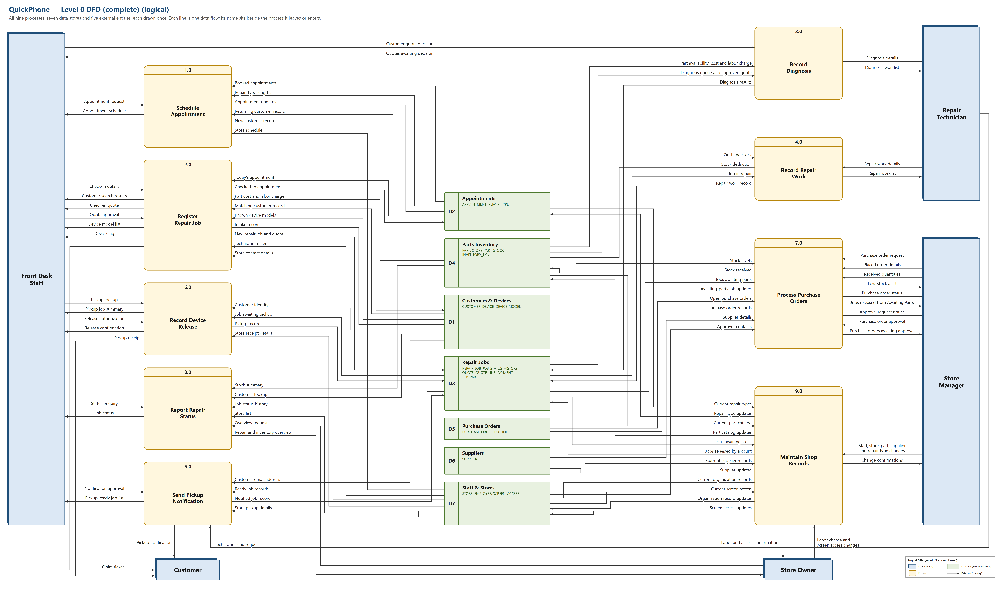
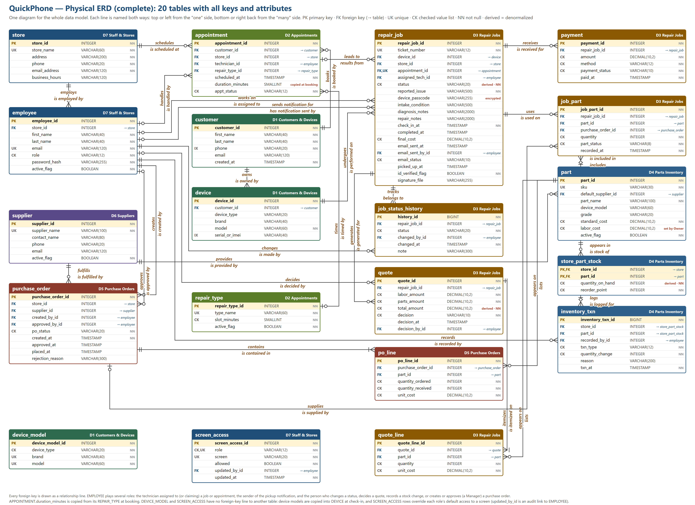

# Planning documents

This folder holds the analysis and design behind the working system in [`../app`](../app).

| Document | File |
|---|---|
| System request | [system-request.docx](system-request.docx) |
| Requirements catalog (15 functional, 6 non-functional) | [requirements-catalog.docx](requirements-catalog.docx) |
| Use cases (UC-01 to UC-13) | [use-cases.docx](use-cases.docx) · [diagram](use-case-diagram.png) |
| Data flow diagrams, logical and physical | [diagrams/dfd](diagrams/dfd) · [physical set (PDF)](diagrams/dfd/physical-dfd-set.pdf) |
| Entity relationship diagrams, logical and physical | [diagrams/erd](diagrams/erd) · [physical ERD (PDF)](diagrams/erd/physical-erd.pdf) |
| DFD to ERD alignment | [dfd-erd-alignment.png](diagrams/dfd-erd-alignment.png) |
| Specification document | [specification.docx](specification.docx) |
| Business rules decided with the owner | [business-rules.md](business-rules.md) |
| Staff training guide | [training-guide.md](training-guide.md) |

## Data flow diagrams

The context diagram and Level 0 come first. Level 0 is shown complete and in four parts, followed by a Level 1 diagram for each process. The logical set shows what the system does, and the physical set shows how it does it. The physical 9.0 has eight processes and is drawn in two parts.

| Diagram | Logical | Physical |
|---|---|---|
| Context | [view](diagrams/dfd/logical/01-context.png) | [view](diagrams/dfd/physical/01-context.png) |
| Level 0, complete | [view](diagrams/dfd/logical/02-level-0.png) | [view](diagrams/dfd/physical/02-level-0.png) |
| Level 0, part 1: booking and check-in | [view](diagrams/dfd/logical/03-level-0-part-1-booking-check-in.png) | [view](diagrams/dfd/physical/03-level-0-part-1-booking-check-in.png) |
| Level 0, part 2: bench | [view](diagrams/dfd/logical/04-level-0-part-2-bench.png) | [view](diagrams/dfd/physical/04-level-0-part-2-bench.png) |
| Level 0, part 3: notice and release | [view](diagrams/dfd/logical/05-level-0-part-3-notice-release.png) | [view](diagrams/dfd/physical/05-level-0-part-3-notice-release.png) |
| Level 0, part 4: back office | [view](diagrams/dfd/logical/06-level-0-part-4-back-office.png) | [view](diagrams/dfd/physical/06-level-0-part-4-back-office.png) |
| 1.0 Schedule appointment | [view](diagrams/dfd/logical/07-level-1-1.0-schedule-appointment.png) | [view](diagrams/dfd/physical/07-level-1-1.0-schedule-appointment.png) |
| 2.0 Register repair job | [view](diagrams/dfd/logical/08-level-1-2.0-register-repair-job.png) | [view](diagrams/dfd/physical/08-level-1-2.0-register-repair-job.png) |
| 3.0 Record diagnosis | [view](diagrams/dfd/logical/09-level-1-3.0-record-diagnosis.png) | [view](diagrams/dfd/physical/09-level-1-3.0-record-diagnosis.png) |
| 4.0 Record repair work | [view](diagrams/dfd/logical/10-level-1-4.0-record-repair-work.png) | [view](diagrams/dfd/physical/10-level-1-4.0-record-repair-work.png) |
| 5.0 Send pickup notification | [view](diagrams/dfd/logical/11-level-1-5.0-send-completion-notice.png) | [view](diagrams/dfd/physical/11-level-1-5.0-send-completion-notice.png) |
| 6.0 Record device release | [view](diagrams/dfd/logical/12-level-1-6.0-record-device-release.png) | [view](diagrams/dfd/physical/12-level-1-6.0-record-device-release.png) |
| 7.0 Process purchase orders | [view](diagrams/dfd/logical/13-level-1-7.0-process-purchase-orders.png) | [view](diagrams/dfd/physical/13-level-1-7.0-process-purchase-orders.png) |
| 9.0 Maintain shop records | [view](diagrams/dfd/logical/14-level-1-9.0-maintain-shop-records.png) | [part 1](diagrams/dfd/physical/14-level-1-9.0-maintain-shop-records-part-1.png) · [part 2](diagrams/dfd/physical/14-level-1-9.0-maintain-shop-records-part-2.png) |

## Entity relationship diagrams

The rendered ERD has 20 entities. The November 20 security implementation adds AuditEvent in D7 (21 entities in the application) and void metadata on Payment in D3; the diagram images still need regeneration for those additions. It is shown in full, then as an overview with three detail views.

| View | Logical | Physical |
|---|---|---|
| Full | [view](diagrams/erd/logical/full.png) | [view](diagrams/erd/physical/full.png) |
| Overview | [view](diagrams/erd/logical/overview.png) | [view](diagrams/erd/physical/overview.png) |
| Detail 1 | [view](diagrams/erd/logical/detail-1.png) | [view](diagrams/erd/physical/detail-1.png) |
| Detail 2 | [view](diagrams/erd/logical/detail-2.png) | [view](diagrams/erd/physical/detail-2.png) |
| Detail 3 | [view](diagrams/erd/logical/detail-3.png) | [view](diagrams/erd/physical/detail-3.png) |

